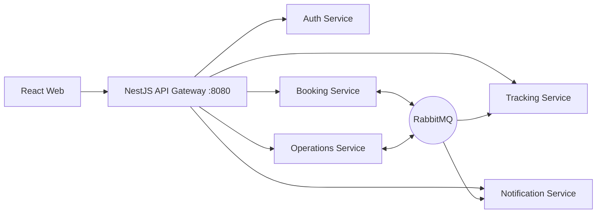
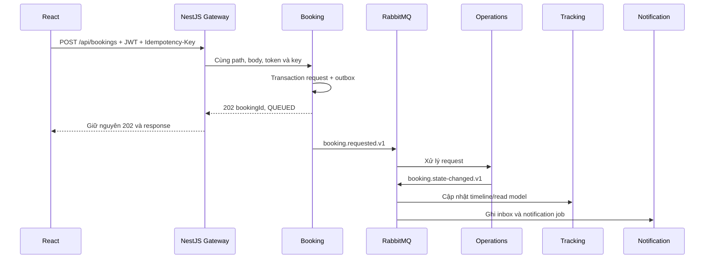

# Architecture

## Vị trí gateway



**NestJS là API Gateway duy nhất** trong thiết kế này. React gọi trực tiếp gateway;
local dùng `http://localhost:8080`. TLS/HTTPS khi deploy cần được cấu hình theo môi
trường, chưa được triển khai trong scaffold HTTP hiện tại.

Gateway là một ứng dụng độc lập. Auth, Booking, Operations, Tracking, Notification
mới là 5 backend service trong kế hoạch. Repo này không tạo thêm domain service.

## Ranh giới trách nhiệm

| Thành phần   | Sở hữu                                                                                                |
| ------------ | ----------------------------------------------------------------------------------------------------- |
| Gateway      | HTTP routing, access JWT/route role, CORS/Origin, rate limit, request ID, logging                     |
| Auth         | Register/login, password, ký RS256 bằng private key, refresh rotation/logout, user profile, tạo staff |
| Booking      | Nhận request, Idempotency-Key, `202 QUEUED`, request/projection/cancellation command, outbox          |
| Operations   | Bàn/slot, allocation, reservation state machine, expectedVersion, chống cấp trùng                     |
| Tracking     | Timeline append-only và projection theo aggregateVersion                                              |
| Notification | Inbox, notification jobs, email/in-app, retry độc lập                                                 |

Gateway không đọc DB, không truy cập refresh session và không publish RabbitMQ.
Gateway không kiểm tra table capacity, trạng thái, thời điểm check-in/no-show, số
version hay quyền sở hữu booking. Các rule đó phải chạy tại domain service.

## Module NestJS

```text
AppModule
  ConfigurationModule       Load/validate env và cung cấp GATEWAY_CONFIG
  LoggerModule              Pino JSON logging
  HealthModule              HealthController
  ProxyModule               ProxyController + ProxyService
    AuthModule              GatewayAccessGuard + JwtVerifierService
      RoutingModule         RouteRegistryService + route definitions
```

[Bootstrap](../src/bootstrap.ts) dùng Express adapter, tắt body parser để giữ stream,
đăng ký request context, Helmet, CORS, rate limit và exception filter.
[ProxyController](../src/modules/proxy/proxy.controller.ts) chạy guard trước khi gọi proxy.
Không mount proxy middleware trước Nest guard vì như vậy có thể bỏ qua authentication.

## Luồng request

1. Sinh UUID request ID, bỏ forwarded headers từ client khi không trust proxy.
2. Security headers, CORS/preflight, global và auth rate limit.
3. Match chính xác method/path của 41 operation V2; route lạ trả 404 trước khi gọi backend.
4. Với API bảo vệ: xác minh JWT RS256 và role. Refresh/logout kiểm tra Origin.
5. Bắt buộc Idempotency-Key với POST Booking; không parse DTO nghiệp vụ.
6. Proxy giữ nguyên `/api`, query, body, token và cookie. Upstream status/body đi
   thẳng về client. Lỗi kết nối/timeout do gateway trả 502/504.

Chi tiết nằm ở [proxy routing](proxy-routing.md) và [authentication](authentication.md).

## Booking bất đồng bộ



Gateway không đợi Operations xác nhận để trả response; `QUEUED` chưa phải `CONFIRMED`.
Notification dừng không làm gateway/Booking ngừng phục vụ. Request trực tiếp tới
Notification đang ngừng có thể trả 502; quá trình lưu event/recovery là trách nhiệm
RabbitMQ và các service, không có queue/retry bổ sung trong gateway.

## Health và vận hành

- `/health/live`: process phục vụ HTTP.
- `/health/ready`: app init xong, config hợp lệ, RSA public key đã load.
- `/api/health`: API health V2 trả `{"gateway":"ok"}`, không gọi backend.
- Không probe mọi backend: một backend hỏng không làm cả gateway mất readiness.
- Shutdown đi qua Nest lifecycle khi nhận SIGTERM/SIGINT; Compose dành 15 giây để đóng.
- Rate limit lưu theo process; muốn nhiều replica dùng counter chung như Redis.
- Không có service discovery/circuit breaker/WebSocket trong phiên bản này.

Gateway dùng một public key được nạp tại startup. Chỉ Auth giữ private key để ký token.
Chi tiết key rotation và giới hạn
token revocation nằm trong [authentication](authentication.md).
